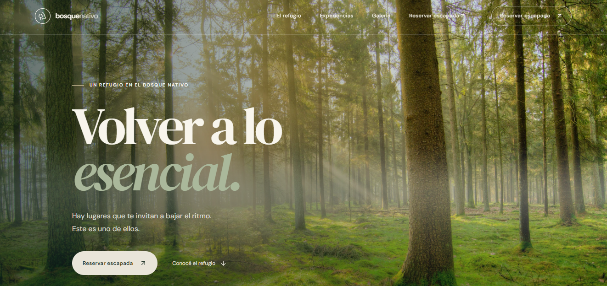

# 🌲 Bosque Nativo | Landing Page Premium


Una landing page de alta gama para un refugio ecológico ficticio ("Bosque Nativo"). El diseño está enfocado en transmitir calma, exclusividad y conexión con la naturaleza a través de una experiencia de usuario inmersiva y animaciones cinematográficas.

Este proyecto fue desarrollado como pieza central de mi portafolio para demostrar habilidades en **Desarrollo Frontend, Animación Web (GSAP) y Diseño de Interfaces (UI/UX)**, así como mi capacidad para integrar herramientas de **Inteligencia Artificial** en el flujo de trabajo de desarrollo.

🔗

---

## ✨ Características Principales (UX/UI)

*   **Dirección de Arte Editorial:** Uso estratégico de tipografía clásica (DM Serif Display) combinada con Sans-Serif moderna (DM Sans) para lograr un look premium y acogedor.
*   **Paleta de Colores Natural:** Tonos tierra, verdes profundos y crema, asegurando un alto contraste y accesibilidad visual.
*   **Diseño Totalmente Responsivo:** Adaptado meticulosamente para móviles, tablets y pantallas de escritorio, manteniendo la jerarquía visual.
*   **Navegación Fluida:** Menú de navegación con "Glassmorphism" que cambia dinámicamente de color según la sección de la página para no perder legibilidad.
*   **Optimización de Imágenes:** Implementación del componente `next/image` con formatos modernos (AVIF/WebP) y carga prioritaria (LCP) para el Hero, garantizando tiempos de carga óptimos.

## 🎬 Animaciones y Rendimiento (GSAP)

*   **Hero Parallax:** Movimiento de capas (niebla y foto de fondo) vinculado tanto al scroll como al movimiento del mouse (Efecto 3D).
*   **Text Reveal:** Animación de entrada del titular principal utilizando `SplitText` de GSAP para revelar el texto línea por línea.
*   **Scroll Pinning (Storytelling):** La sección "Un día en el bosque" se fija en la pantalla (pin) mientras el usuario hace scroll, revelando 4 escenas consecutivas que transicionan del día a la noche.
*   **Micro-interacciones:** Efectos hover suaves (escalado y transiciones de opacidad) en tarjetas de experiencias y galería.
*   **Accesibilidad (a11y):** Respeto absoluto a la media query `prefers-reduced-motion`, desactivando las animaciones complejas si el usuario tiene esa preferencia configurada en su sistema operativo.

## 🛠️ Stack Tecnológico

*   **Framework:** Next.js 14 (App Router)
*   **Lenguaje:** TypeScript
*   **Estilos:** Tailwind CSS + CSS Modules personalizados
*   **Animaciones:** GSAP (ScrollTrigger, SplitText, `@gsap/react`)
*   **Iconografía:** Lucide React
*   **Tipografías:** Google Fonts

---

## 🤖 Metodología de Desarrollo Híbrida (AI-Assisted)

Este proyecto fue desarrollado utilizando un enfoque moderno de **desarrollo asistido por Inteligencia Artificial**. En lugar de depender de una sola herramienta, utilicé un flujo de trabajo iterativo y multi-IA:

*   **Generación de Base y Estructura:** Utilicé **ChatGPT** para generar la estructura inicial de los componentes, la configuración de Next.js y la lógica base del formulario.
*   **Animaciones Complejas:** Implementé **Claude** como copiloto para estructurar los timelines complejos de GSAP (especialmente el *Scroll Pinning* de la sección "Un día en el bosque").
*   **Refactorización y Debugging Manual:** El código generado por IA fue sometido a una revisión profunda y modificaciones manuales por mi parte. Resolví problemas técnicos avanzados de React/Next.js (como errores de hidratación SSR, ajustes finos de `z-index` para que las fotos no se ocultaran y optimización de la carga de imágenes).
*   **Dirección de Arte y UX/UI:** El diseño visual, la paleta de colores, la selección tipográfica y el copywriting fueron definidos por mí, usando las IAs para traducir esas ideas a código Tailwind y CSS.

Esta metodología me permitió acelerar el desarrollo sin sacrificar la calidad, demostrando mi capacidad para **supervisar, auditar y refactorizar código generado por IA**, una habilidad clave para los roles de AI-Builder.

---

## ⚙️ Cómo correr el proyecto localmente

Si quieres probar el código en tu máquina:

1. Clona el repositorio:
   ```bash
   git clone https://github.com/TU_USUARIO/bosque-nativo-landing.git